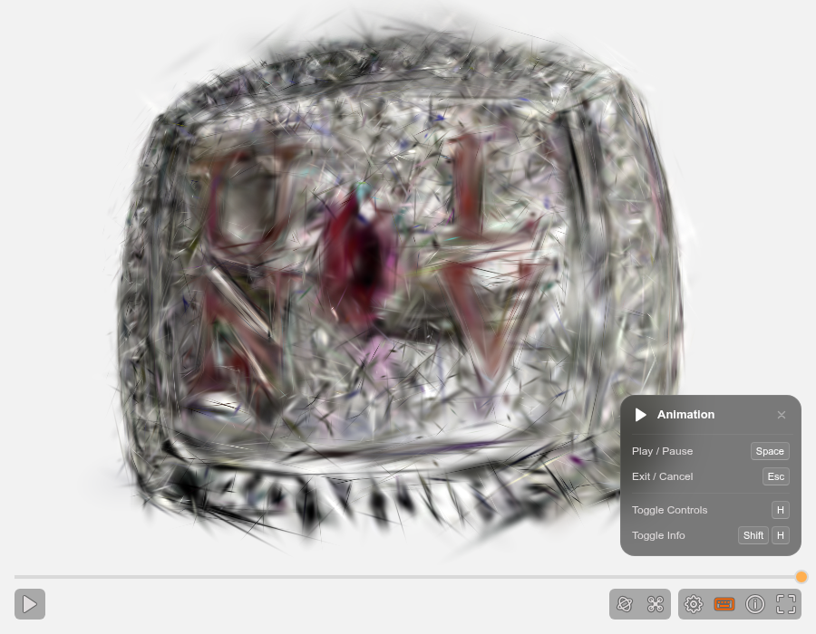

## About ==Data Insight Solutions==
@section: hero
@eyebrow: About
@tagline: Data Insight Solutions
@mark-alt: The Data Insight Solutions mark

Data Insight Solutions LLC is a Missouri limited liability company, formed in 2023, and a consultancy in Ava, Missouri, working remotely with teams anywhere. It does enterprise Orange Logic digital asset management (DAM) consulting, custom integrations, and AI agents that keep a person in control. It is also home to Reckons.AI, the custom software behind this site. Work is project-based and starts with a discovery, and you deal directly with the person who does the work.

- [Talk about your project →](/contact/)

## ==Matthew Roe==, owner-operator
@section: text
@id: owner

I'm Matthew Roe, the owner-operator of Data Insight Solutions: a solutions architect for DAM and an AI systems integrator. I'm currently a DAM Developer / Software Engineer at VF Corp (contract through Apex Systems, October 2025 – present, remote), building enterprise Orange Logic automations and integrations. Earlier, I was Solution Engineer, then Solutions Architect, at Orange Logic (November 2023 – September 2025), serving many clients, most not disclosable.

## The career line
@section: blocks
@id: background
@eyebrow: Experience and credentials

### Experience
@as: timeline
@span: tall
@note: The Orange Logic, Submittable and Univision Computers logos are shown only to describe my professional background. All trademarks belong to their owners, and no affiliation or endorsement is implied.
- Oct 2025 – present | VF Corp | DAM Developer / Software Engineer (contract through Apex Systems)
- Nov 2023 – Sep 2025 | Orange Logic | Solution Engineer, then Solutions Architect | logo: /assets/logos/orange-logic.svg
- May 2021 – Aug 2023 | Submittable | Solution Engineer, Senior Solution Engineer, Solutions Architect | logo: /assets/logos/submittable.svg
- Oct 2016 – May 2021 | Univision Computers | Automation Manager & Field Engineer | logo: /assets/logos/univision-computers.webp

### Credentials
**Current:**

- AWS Certified Solutions Architect – Associate, issued December 2024, valid to December 2027 — [verify](https://www.credly.com/badges/d9efb272-a2e8-4162-8fb9-6fb7f266ef69) | valid-until: 2027-12-01
- Data Science and Machine Learning: Making Data-Driven Decisions, Great Learning & MIT, February 2024 — [verify](https://olympus1.mygreatlearning.com/certificate/XKUKUPWI)

**Earlier certifications (expired):**

- Microsoft Power Platform Solutions Architect Expert (2022)
- Microsoft Power Platform Functional Consultant Associate (2022)
- Microsoft Azure Data Fundamentals (2021)
- Microsoft Power Platform Fundamentals (2020)

### Education and research
- University of Nevada, Las Vegas, 2014–2016: MS (thesis) in Management Information Systems
- University of Nevada, Las Vegas, 2011–2014: BA in Psychology
- UNLV Interactive Measurement Lab, 2013–2016; published "Is sadness blue? The problem of using figurative language for emotions on psychological tests" in *Behavior Research Methods* (2016).

### Recognition
Microsoft Semantic Kernel Hackathon winner, and the first round-trip Philanthropy Data Commons integration with Submittable — both outside the Orange Logic consulting offer.

Division I collegiate swimming: three conference championships, and ranked in the US top 100 in the 1650 freestyle.

### Media
@as: media

### Community
Matthew works with the Ava Lions Foundation (Ava Lions Club, Lions Clubs International) and the Ava Saturday Farmers Market (Ava Growers Project).

### Reckons.AI
@span: wide
Matthew is building Reckons.AI, the custom software behind this site: MIT licensed, works offline, no account, no seat count, and knowledge in plain-text files. Demos of asset generation and local, subscription-free processes are coming.

### The ring, rebuilt in 3D
@span: wide
This ring was filmed on a scan board and reconstructed into a 3D Gaussian splat with Reckons.AI's local pipeline. It is rebuilt from photographs of the real object, not generated by a model, so it shows what the camera saw (the underside was never filmed).

Open the still to turn the ring yourself: drag to rotate.
